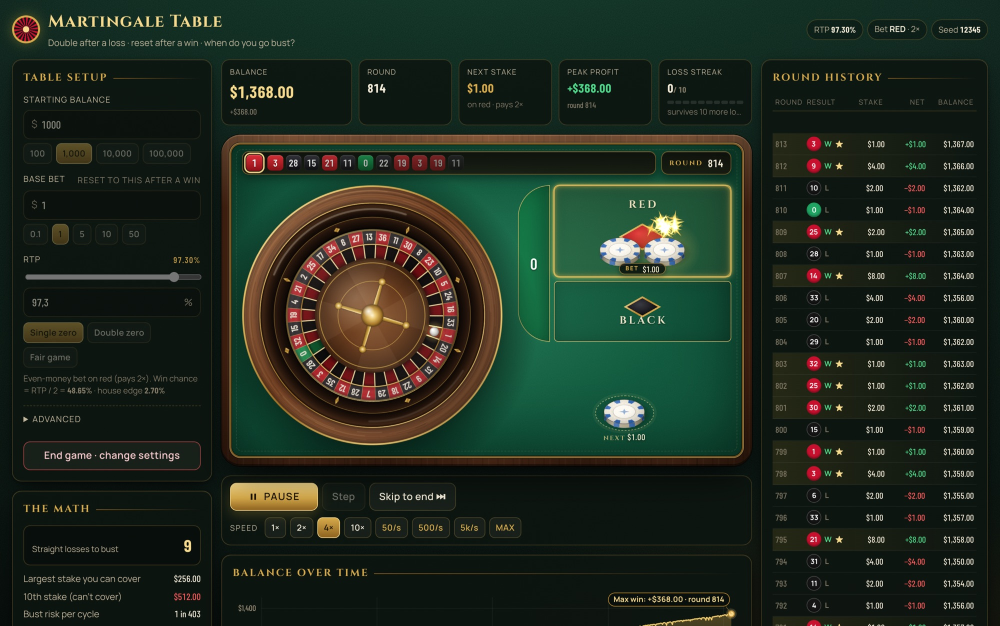

# Martingale Table

**Watch the Martingale betting strategy play out live on a roulette-style table — and see exactly when it busts.**

Set a bankroll, a base bet and the game's RTP, then let the wheel spin. Every round is animated at real speed, or you can crank it up to thousands of rounds per second and watch the balance chart instead. When the bankroll finally can't cover the next doubled stake, you get a full breakdown: the round you went bust, and the round and amount of your **maximum win** along the way.



## Features

- **Live roulette-style table** — wheel, ball, chips, win/loss effects and a history board, rendered with PixiJS.
- **Your numbers** — starting balance, base bet, RTP (with single-zero / double-zero / fair-game presets), seed and round limit.
- **Eight speeds** — 1×, 2×, 4×, 10× fully animated, then 50 / 500 / 5,000 rounds per second and MAX, plus *Step* and *Skip to end*.
- **Balance chart** — the whole run on one chart (millions of rounds are down-sampled without losing spikes), with the peak and the bust marked.
- **End-of-game summary** — bust round, max win (amount + round), realized RTP, longest losing streak, biggest stake, total wagered.
- **The math, up front** — how many straight losses bust you, the largest stake you can cover, bust risk per cycle, and a 1,000-game Monte Carlo distribution of the bust round.
- **Reproducible** — a seeded PRNG means the same seed replays the same game.

## How the simulation works

Every round is an even-money bet on **red** that pays 2×.

| Rule | |
| --- | --- |
| Win probability | `p = RTP / 2` (RTP 97.3% → 48.65%, the odds of red on a single-zero wheel) |
| After a win | stake resets to the base bet |
| After a loss | stake doubles |
| **Bust** | the stake required for the next round is larger than the remaining balance |

Each winning *cycle* (a run of losses ended by a win) nets exactly one base bet. The catch is the losing streak. With balance `B` and base bet `b`, you can afford `k` stakes in a row, where `k` is the largest number with `b · (2^k − 1) ≤ B`. Lose all `k` and you're out. That happens with probability `(1 − p)^k` per cycle. The chance is small, but it is certain to happen eventually.

The *Monte Carlo* panel plays 1,000 independent games with your settings and reports the median, mean and 10th–90th percentile bust round. The summary then tells you how your game compares.

> With a house edge, no staking system changes the expected value. Martingale only trades many small wins for one rare, catastrophic loss.

## Controls

| Key | Action |
| --- | --- |
| `Space` | Start / pause / resume |
| `→` | Play a single round |
| `1` – `8` | Pick a speed |
| `↑` / `↓` | Faster / slower |

## Getting started

Requires **Node.js 22.18+**.

```bash
npm install
npm run dev       # http://localhost:5173
```

| Script | |
| --- | --- |
| `npm run dev` | Start the dev server |
| `npm run build` | Production build into `dist/` |
| `npm run preview` | Serve the production build |
| `npm test` | Engine tests (Node's built-in test runner) |
| `npm run check` | Type-check with `svelte-check` |

## Project structure

```
src/
├── lib/engine/      Pure TypeScript: Martingale engine, seeded PRNG, analysis + Monte Carlo, chart buffer
├── lib/sim/         Svelte 5 runes controller: game loop, speeds, skip/step, history
├── lib/stage/       PixiJS table and wheel (StageApi contract in types.ts)
├── lib/chart/       Balance chart
└── lib/ui/          Setup, analysis, HUD, transport, history and summary panels
tests/               Engine tests
```

The engine has no UI dependencies. It works in integer cents and advances tens of millions of rounds per second, so *Skip to end* finishes almost instantly.

## Deploying to GitHub Pages

The repository includes `.github/workflows/deploy.yml`. To publish:

1. Push the repository to GitHub.
2. Under **Settings → Pages**, set **Source** to *GitHub Actions*.

Every push to `main` then runs the tests, builds the app and publishes it. Asset paths are relative (`base: './'`), so it works under `https://<user>.github.io/<repo>/`.

## Disclaimer

This is an educational simulation. No real money is involved, and it is not gambling advice.

## License

[MIT](LICENSE)
